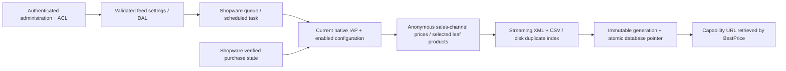

# Architecture and data model

No sibling plugin dependency. Backend boundaries: Configuration, Catalog, Feed, Entitlements, Pricing, Analytics, Controllers, Queue and ScheduledTask. All PHP uses strict types and DI. Migration creates only stpi_gh_bp_feed, stpi_gh_bp_build and stpi_gh_bp_conversion. FeedDefinition is native DAL; its fields are not ApiAware, preventing generic entity writes from bypassing the guarded actions. Builds and conversion ledger are internal DBAL records with feed foreign keys. Order/customer/catalog data remains in Shopware.

Price and identity are not remappable. Product mappings accept only explicit property groups or scalar custom fields; never evaluate Twig/PHP/user expressions. Sales-channel rule loading precedes price calculation. SEO paths are loaded per catalog batch. Public feed GET never generates products. XML/CSV are uploaded as immutable generations to Shopware private Flysystem storage. One transactional database pointer publishes both files together; a revision/enable check in that transaction rejects stale builds. Failed generation records a diagnostic and keeps the previous manifest. Empty/all-invalid feeds do not replace the previous valid feed.

The local catalog reads in pages of 100 with keyset IDs, association preloads and deterministic ID sorting. This is not a database snapshot across the full build. Duplicate IDs use a temporary SQLite disk index for bounded PHP memory. Only temporary workspaces live in the OS temporary directory with mode 0700. Published files use the configured Shopware private filesystem under stpi-gh-bestprice/. Database advisory locks serialize generation per feed. Cluster deployments require shared private storage and a shared database; multi-node acceptance remains untested.

Configuration revision is rechecked before publication. Native DAL hooks and database transactions retain referential integrity. Configuration creation uses a DB advisory lock to avoid concurrent free-tier duplication. CSV formula-leading cells are prefixed with an apostrophe. This security transform is a merchant-export convention, pending confirmation of BestPrice's CSV dialect.

Queue retries use the hosting Shopware Messenger policy. Permanent disabled/deleted/expired-feature jobs are cancelled. Running builds check entitlements before publishing; builds are atomic but lack a cancellation button/checkpoint resume. Do not claim incremental or distributed resumable processing. build/error record retention is 90 days; dedup ledger proposal is 180 days. File cleanup retains current generation and at least one day of older files; complete uninstall removes only its private filesystem prefix.

Implemented pricing is a preview. It never changes merchant prices. Profitability accepts complete net costs and shows source merchant-input; no BestPrice visitor, click, revenue or RoAS values are fabricated. Automated repricing, cost-report ingestion, historical analytics and fashion grouping remain open work, not external API features.
