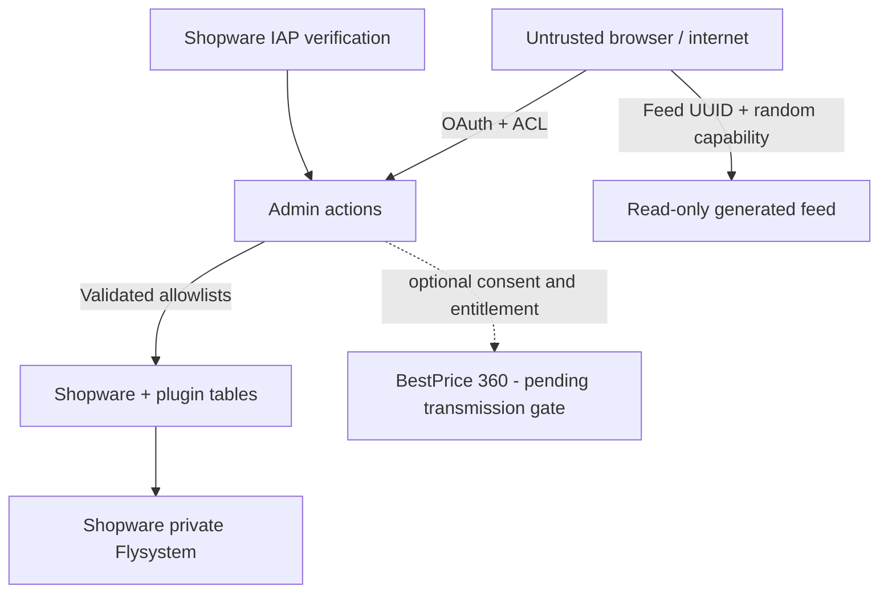

# Security and privacy review

Development review 2026-11-24; not an independent certification. Skill used: security-review. Runtime checks are separate from this design review.

| Threat | Control / evidence required |
|---|---|
| Premium direct API bypass | Guard in services, public extra-feed downloads and feed builder; frontend hiding is only UX; test restricted API and queue calls |
| Generic DAL bypass | No ApiAware on configuration fields; verify write API cannot persist protected settings |
| Unauthorized catalog export | Explicit nonempty selection; active visibility filter; inherited leaf variant data; no customer/cost/stock quantity export |
| SQL injection | Bound query parameters; fixed identifiers; DAL writes; validated UUIDs and clamped pagination |
| XML/XXE | Writer uses XMLWriter text escaping; no arbitrary XML import or DTD fetch; DOM tests use LIBXML_NONET |
| XSS | Vue escaped interpolation; no v-html; JSON attributes escaped if tracking is enabled later |
| SSRF | No server-side fetching of merchant URLs/images/feed URLs; remote sources restricted to known documented services |
| CSV injection | Formula prefix escaping, explicit quoting, no escape character ambiguity |
| Traversal / arbitrary file reads | UUID and format allowlists; manifest build ID regex; storage confined to its private filesystem prefix |
| Feed capability exposure | 256-bit random URL key, constant-time comparison, private revalidation cache, noindex/nofollow, referrer restriction; redact path keys in proxy logs |
| Duplicate/concurrent builds | Database advisory locks, atomic publication and revision/entitlement rechecks; multi-node operation untested |
| Information leakage | Public errors have stable codes; admin roles separate configuration/license/pricing/analytics; no raw secret-bearing payload logs |
| Tracking without consent / revocation | Release blocker pending concrete permission and browser test evidence; no claim that a SDK automatically satisfies privacy law |
| Order manipulation | Requires core-authorized order context, per-feed stable pseudonym and atomic unique ledger; full implementation tests remain open |
| Supply chain | Locked dev dependencies; Composer audit, SBOM, secret scan and archive allowlist required before release |

No manufacturer telemetry. No API secret has been requested or persisted. Feed URL keys are capability secrets in private settings; a server/database operator can read them. Restrict database backups and support exports. A documented encrypted credential vault is required before adding any secret merchant API credential; no such API currently exists in the implementation.

## Data minimization / retention

Public feeds contain selected product data, not customers, orders, internal purchasing costs or full inventory quantities. Build diagnostics retain product UUID and field/code only. Builds retain counts/timing/error codes. No full XML input or customer mail archive is retained. Configuration retention follows uninstall keepUserData. Remove data option deletes only plugin tables/systemConfig prefix and its private filesystem prefix; verify both lifecycle options on the exact archive.

The merchant is responsible for its privacy notice, lawful basis and relationship with BestPrice. Greek/Cypriot national rules and legal documents require competent review; no blanket GDPR guarantee is made. Before activating any tracking, verify the actual cookie/network contract, third-party retention, recipient role, subprocessors, international transfers and withdrawal behavior. Avoid assuming consent merely because an order was placed.
